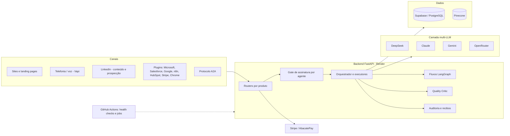

# AION — plataforma multiagente de IA (vitrine de engenharia)

AION é uma plataforma de agentes de IA que projetei e construí de ponta a ponta, **implantada e rodando em produção**: agentes baseados em LLMs para compliance regulatório, documentação de engenharia, recepção por voz e prospecção comercial, servidos por um backend FastAPI com cobrança por assinatura, auditoria e controle de acesso por agente.

Esta vitrine é **curada e sem segredos**: mostra a estrutura, as decisões de arquitetura e trechos reais de código. Os repositórios completos são privados por conterem lógica comercial e de clientes. Cada afirmação aqui aponta para evidência no código; o que ainda está em construção está identificado como tal.

*(A documentação em `docs/` está em português, exceto os post-mortems técnicos e os exemplos de código, que estão em inglês.)*

## Os quatro eixos

| Eixo | Em uma frase | Detalhe |
|---|---|---|
| **Multiagentes** | Orquestrador com planner, router, coordinator e synthesizer; executor por agente com gate de assinatura; protocolo A2A; fluxo de voz em LangGraph; validação de saída por Quality Critic; camada multi-LLM com fallback | [MULTIAGENT_ARCHITECTURE](docs/MULTIAGENT_ARCHITECTURE.md) |
| **Infraestrutura** | Contêiner Docker no Render com três processos supervisionados, disco persistente, jobs agendados e health checks; manifestos de Kubernetes, Terraform, Cloud Build e Prometheus/Grafana prontos | [INFRASTRUCTURE](docs/INFRASTRUCTURE.md) |
| **Segurança** | Gate de assinatura, circuit breaker, trilha de auditoria e recibos no caminho de execução; **Agent Guard** (máscara de PII, orçamento e política por agente em um ponto central, em integração); proteção de propriedade intelectual por nível | [SECURITY](docs/SECURITY.md) · [AGENT_GUARD](docs/AGENT_GUARD.md) |
| **Compliance** | Produto (SOC 2, ISO 27001, EU AI Act, CSRD, NR-1, LGPD, carbono, CBS/IBS…) e plataforma (consentimento, solicitações de titular, recibos de auditoria de IA) | [COMPLIANCE](docs/COMPLIANCE.md) |

## Portfólio

- **[Portfólio de agentes](docs/AGENT_PORTFOLIO.md):** todos os agentes, por domínio, com o que fazem, o LLM e a **evidência no código** (implementado, parcial, esqueleto ou catalogado).
- **[Plugins e integrações](docs/PLATFORM_INTEGRATIONS.md):** como os agentes chegam a Microsoft, Salesforce, Google, n8n, HubSpot, Stripe, Chrome, MCP e marketplaces.
- **[Orbit](docs/ORBIT.md):** motor de análise ICT/SMC em Go, derivado do OpenProphet (CC BY-NC 4.0), com o trabalho próprio e a atribuição.
- **[Maturidade](docs/MATURITY.md):** quais produtos foram testados ponta a ponta contra a API implantada.
- **[Post-mortem do agente de LinkedIn](docs/INCIDENT_LINKEDIN_AGENT.md):** diagnóstico e correção de um incidente real de operação.

## Arquitetura

## A vaga pede → onde está na estrutura

### Responsabilidades
| Responsabilidade | Onde ver |
|---|---|
| Identificar oportunidades de IA | Cada vertical parte de um processo real: compliance, engenharia, atendimento por voz, prospecção → [AGENT_PORTFOLIO](docs/AGENT_PORTFOLIO.md) |
| Projetar e evoluir agentes e soluções com LLMs | Módulos por produto e fluxos em LangGraph → [voice_call_langgraph_excerpt.py](examples/voice_call_langgraph_excerpt.py) |
| Protótipos, PoCs e MVPs | Níveis de maturidade, do endpoint experimental ao produto com assinatura → [MATURITY](docs/MATURITY.md) |
| IA generativa, RAG, automação e APIs | RAG com Pinecone e embeddings (OpenAI, fallback OpenRouter) para detectar conteúdo duplicado → [seo_semantic_memory_excerpt.py](examples/seo_semantic_memory_excerpt.py); API de Documentos do LinkedIn → [linkedin_document_upload_excerpt.py](examples/linkedin_document_upload_excerpt.py); Stripe, Vapi, A2A |
| Requisitos e arquitetura com Produto e Tecnologia | Arquitetura documentada e decisões registradas → [MULTIAGENT_ARCHITECTURE](docs/MULTIAGENT_ARCHITECTURE.md) |
| Testar, avaliar e otimizar a qualidade | Catálogo determinístico + LLM em perguntas estreitas → [csrd_deterministic_agent.py](examples/csrd_deterministic_agent.py); Quality Critic; suíte de testes |
| Métricas, resultados e adoção | Telemetria de custo e uso por chamada; health checks e relatórios agendados |
| Pesquisar novas tecnologias | A2A, MCP, troca de provedor de LLM sem reescrever agentes |
| Segurança, qualidade e governança | [SECURITY](docs/SECURITY.md) e [COMPLIANCE](docs/COMPLIANCE.md); trilha Merkle → [merkle_audit_chain.py](examples/merkle_audit_chain.py) |

### O que a vaga busca
| Busca | Evidência |
|---|---|
| Experiência prática com IA generativa | Produtos que geram relatórios e documentos reais (PDF, DOCX) |
| LLMs, prompt engineering, RAG, agentes, APIs | Prompts de escopo estreito, saída estruturada validada em código, executores de agentes, integrações externas |
| Produtos e automações baseados em IA | Plataforma implantada com cobrança por assinatura e agente comercial agendado |
| Transformar problema de negócio em solução | Formação em engenharia de produção e anos de gestão de projetos aplicados ao desenho dos agentes |
| Autonomia ponta a ponta | Do desenho ao deploy e à operação, incluindo diagnóstico de incidentes |
| Ambiente dinâmico, várias áreas | Produto, jurídico e compliance, vendas e infraestrutura no mesmo ciclo |

### Diferenciais
| Diferencial | Situação |
|---|---|
| Anthropic, Gemini, DeepSeek e OpenAI | Claude e Gemini por clientes diretos, DeepSeek como padrão, OpenAI para embeddings e acesso a outros modelos pelo gateway OpenRouter |
| LangGraph | Em uso (fluxo de voz com nós concorrentes e nó de compliance) |
| Python | Backend inteiro; Go no Orbit |
| Produtos digitais e inovação | Plataforma, sites, plugins e listagens em marketplaces |
| Arquitetura de agentes e multimodalidade | Orquestração, A2A e MCP; voz (telefonia) e documentos |

## Princípios de design

1. **O LLM não toma a decisão que importa.** Catálogos reais conduzem a avaliação; funções determinísticas calculam pontuação e limiares.
2. **Agentes são grafos, não prompts soltos.** O pipeline de voz roda em LangGraph, com nós concorrentes e um nó de compliance que grava o recibo de auditoria.
3. **Governança é código e é honesta:** cada controle é marcado como *ligado* ou *implementado, ainda não integrado*.
4. **Rodar o que se constrói.** Health checks agendados, telemetria de custo e post-mortems escritos.

## Verifique você mesmo

Os comandos em [docs/DEPLOYMENT_EVIDENCE.md](docs/DEPLOYMENT_EVIDENCE.md) mostram o backend no ar, a documentação OpenAPI e os sites.

## Stack

Python · Go · FastAPI · LangGraph · DeepSeek, Claude, Gemini, OpenRouter · Supabase/PostgreSQL · Pinecone · Stripe · Vapi · Docker · Render · Kubernetes · Terraform · GitHub Actions · MCP · A2A

## Contato

Cristiano Almeida Arruda · Engenheiro de IA · [linkedin.com/in/cristiano-arruda](https://www.linkedin.com/in/cristiano-arruda) · São Paulo
