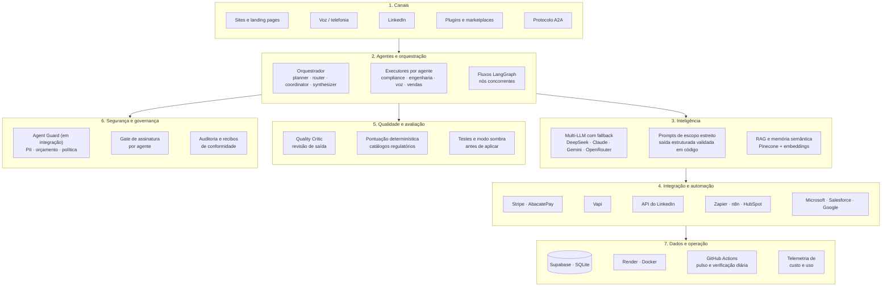

# AION — plataforma multiagente de IA

AION é uma plataforma de agentes de IA que projetei e construí de ponta a ponta, **implantada e rodando em produção**: agentes baseados em LLMs para compliance regulatório, documentação de engenharia, recepção por voz e prospecção comercial, servidos por um backend FastAPI com cobrança por assinatura, auditoria e controle de acesso por agente.

Este repositório é uma **vitrine curada e sem segredos**: mostra a arquitetura, as decisões de design e trechos reais de código. Os repositórios completos são privados por conterem lógica comercial e de clientes. Cada afirmação aponta para evidência no código; o que ainda está em construção está identificado como tal.

*(A documentação em `docs/` está em português, exceto os post-mortems técnicos e os exemplos de código, que estão em inglês.)*

## Arquitetura

Sete camadas, da entrada do usuário até a operação. Cada bloco existe no código.

| Camada | O que contém | Detalhe |
|---|---|---|
| **1. Canais** | Sites, telefonia, LinkedIn, plugins e o protocolo A2A: várias portas para o mesmo conjunto de agentes | [Plugins e integrações](docs/PLATFORM_INTEGRATIONS.md) |
| **2. Agentes e orquestração** | Orquestrador, executores por agente com gate de assinatura, fluxos em LangGraph | [Multiagentes](docs/MULTIAGENT_ARCHITECTURE.md) |
| **3. Inteligência** | Camada multi-LLM, prompts de escopo estreito e RAG como memória semântica | [Multiagentes](docs/MULTIAGENT_ARCHITECTURE.md) |
| **4. Integração e automação** | Cobrança, telefonia, redes e plataformas de automação | [Plugins e integrações](docs/PLATFORM_INTEGRATIONS.md) |
| **5. Qualidade e avaliação** | Revisão de saída, pontuação em código e rollout em modo sombra | [Maturidade](docs/MATURITY.md) |
| **6. Segurança e governança** | Gate de assinatura, auditoria e recibos em produção; proteção central de chamadas de LLM (Agent Guard) em integração | [Segurança](docs/SECURITY.md) · [Agent Guard](docs/AGENT_GUARD.md) · [Compliance](docs/COMPLIANCE.md) |
| **7. Dados e operação** | Banco, contêineres, jobs agendados, verificação de saúde dos agentes, alertas de erro e telemetria | [Infraestrutura](docs/INFRASTRUCTURE.md) · [Saúde e erros](docs/HEALTH_AND_ERROR_REPORTING.md) |

## Capacidades

| Capacidade | Como é feita | Onde ver |
|---|---|---|
| **Agentes e orquestração** | Executores por agente, orquestrador com planner, router, coordinator e synthesizer, protocolo A2A e MCP | [Multiagentes](docs/MULTIAGENT_ARCHITECTURE.md) |
| **Modelos de linguagem** | DeepSeek como padrão, Claude e Gemini por clientes diretos, OpenRouter como gateway, com fallback entre provedores | [Multiagentes](docs/MULTIAGENT_ARCHITECTURE.md) |
| **Engenharia de prompts** | Prompts de escopo estreito, saída estruturada validada em código e catálogo regulatório que conduz a avaliação | [csrd_deterministic_agent.py](examples/csrd_deterministic_agent.py) |
| **RAG e memória semântica** | Índice vetorial no Pinecone, embeddings da OpenAI (fallback pelo OpenRouter), detecção de conteúdo duplicado por similaridade | [seo_semantic_memory_excerpt.py](examples/seo_semantic_memory_excerpt.py) |
| **Automação e integrações via API** | Stripe, Vapi, API de Documentos do LinkedIn, Zapier, n8n, HubSpot e plugins Microsoft, Salesforce e Google | [linkedin_document_upload_excerpt.py](examples/linkedin_document_upload_excerpt.py) |
| **Fluxos de agentes** | Pipeline de voz em LangGraph com nós concorrentes e nó de compliance | [voice_call_langgraph_excerpt.py](examples/voice_call_langgraph_excerpt.py) |
| **Avaliação e qualidade** | Revisão de saída, pontuação determinística, testes automatizados, revisão de código e rollout em modo sombra | [Agent Guard](docs/AGENT_GUARD.md) |
| **Métricas e adoção** | Log de execução por agente (duração, sucesso, commit implantado), telemetria de custo e status do guard | [Saúde e erros](docs/HEALTH_AND_ERROR_REPORTING.md) |
| **Segurança e governança** | Gate de assinatura, trilha de auditoria e recibos em produção; máscara de PII, orçamento diário e política por agente (inclusive para agentes novos) em integração pelo Agent Guard | [Agent Guard](docs/AGENT_GUARD.md) · [Segurança](docs/SECURITY.md) |
| **Entrada multimodal** | Voz por telefonia e documentos, com transcrição classificada e resumida por agentes | [voice_call_langgraph_excerpt.py](examples/voice_call_langgraph_excerpt.py) |
| **Do protótipo ao produto** | Níveis de maturidade, do endpoint experimental ao produto com assinatura | [Maturidade](docs/MATURITY.md) |
| **Operação** | Pulso de saúde a cada 30 minutos, verificação profunda diária com amostra viva de agentes, detecção de pico de erro por agente, relatório persistido e alerta por e-mail, post-mortems escritos | [Saúde e erros](docs/HEALTH_AND_ERROR_REPORTING.md) · [Post-mortem](docs/INCIDENT_LINKEDIN_AGENT.md) |

## Portfólio

- **[Portfólio de agentes](docs/AGENT_PORTFOLIO.md):** todos os agentes, por domínio, com o que fazem, o LLM e a **evidência no código** (implementado, parcial, esqueleto ou catalogado).
- **[Plugins e integrações](docs/PLATFORM_INTEGRATIONS.md):** como os agentes chegam a Microsoft, Salesforce, Google, n8n, HubSpot, Stripe, Chrome, MCP e marketplaces.
- **[Orbit](docs/ORBIT.md):** motor de análise ICT/SMC em Go, derivado do OpenProphet (CC BY-NC 4.0), com o trabalho próprio e a atribuição.

## Princípios de design

1. **O LLM não toma a decisão que importa.** Catálogos reais conduzem a avaliação; funções determinísticas calculam pontuação e limiares.
2. **Agentes são grafos, não prompts soltos.** O pipeline de voz roda em LangGraph, com nós concorrentes e um nó de compliance que grava o recibo de auditoria.
3. **Segurança é da arquitetura, não de cada agente.** Um ponto central, em integração, protege toda chamada de LLM para que um agente novo nasça protegido.
4. **Governança honesta.** Cada controle é marcado como *ligado* ou *implementado, ainda não integrado*.
5. **Rodar o que se constrói.** Verificação de saúde agendada que detecta e reporta, sem autocorreção às cegas; telemetria de custo e post-mortems escritos.

## Verifique você mesmo

Os comandos em [docs/DEPLOYMENT_EVIDENCE.md](docs/DEPLOYMENT_EVIDENCE.md) mostram o backend no ar, a documentação OpenAPI e os sites.

## Stack

Python · Go · FastAPI · LangGraph · DeepSeek, Claude, Gemini, OpenRouter · Supabase/PostgreSQL · Pinecone · Stripe · Vapi · Docker · Render · Kubernetes · Terraform · GitHub Actions · MCP · A2A

## Contato

Cristiano Almeida Arruda · Engenheiro de IA · [linkedin.com/in/cristiano-arruda](https://www.linkedin.com/in/cristiano-arruda) · São Paulo
