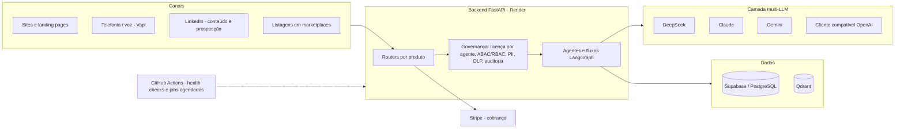

# AION — plataforma multiagente de IA (vitrine de engenharia)

AION é uma plataforma de agentes de IA que projetei e construí de ponta a ponta, **implantada e rodando em produção**: agentes baseados em LLMs para compliance regulatório, documentação de engenharia, recepção por voz e prospecção comercial autônoma, servidos por um backend FastAPI com cobrança, trilha de auditoria e controle de acesso por agente.

Este repositório é uma **vitrine curada e sem segredos**: mostra a estrutura, a forma de pensar e trechos reais de código. Os repositórios completos do produto são privados por conterem lógica comercial e de clientes.

*(A documentação em `docs/` está em inglês.)*

## Arquitetura

## A vaga pede → onde está na estrutura

### Responsabilidades
| Responsabilidade | Onde ver |
|---|---|
| Identificar oportunidades de IA em produtos e processos | Cada vertical parte de um processo real: compliance (SOC 2, ISO 27001, EU AI Act, CSRD, LGPD…), engenharia (projeto → documento → conformidade), atendimento por voz, prospecção. Ver [docs/MATURITY.md](docs/MATURITY.md) |
| Projetar, desenvolver e evoluir agentes, assistentes e soluções com LLMs | Módulos de agentes por produto; fluxos em LangGraph → [examples/voice_call_langgraph_excerpt.py](examples/voice_call_langgraph_excerpt.py) |
| Protótipos, PoCs e MVPs | Os níveis de maturidade mostram o caminho de endpoint experimental até produto com assinatura → [docs/MATURITY.md](docs/MATURITY.md) |
| IA generativa, RAG, automação e integrações via API | Camada multi-LLM; cliente Qdrant e base de conhecimento por cliente no agente de voz; integrações com Stripe, Vapi e a API de Documentos do LinkedIn → [examples/linkedin_document_upload_excerpt.py](examples/linkedin_document_upload_excerpt.py) |
| Requisitos e arquitetura com Produto e Tecnologia | Documentos de handoff por produto e níveis de maturidade; decisões registradas |
| Testar, avaliar e otimizar a qualidade dos agentes | Padrão "catálogo determinístico + LLM em perguntas estreitas" → [examples/csrd_deterministic_agent.py](examples/csrd_deterministic_agent.py); agente revisor de qualidade e segurança; suíte de testes |
| Métricas, resultados e adoção | Telemetria de custo e uso por chamada; workflows de health check e relatórios agendados |
| Pesquisar novas tecnologias | Protocolos MCP e A2A; troca de provedor de LLM sem reescrever agentes |
| Segurança, qualidade e governança | Licença por agente, ABAC/RBAC, mascaramento de PII, DLP, circuit breaker, kill-switch de custo e cadeia de auditoria à prova de adulteração → [examples/merkle_audit_chain.py](examples/merkle_audit_chain.py) |

### O que a vaga busca
| Busca | Evidência |
|---|---|
| Experiência prática com IA generativa | Produtos de compliance e engenharia que geram relatórios e documentos reais (PDF, DOCX) |
| LLMs, prompt engineering, RAG, agentes, APIs | Prompts de escopo estreito, saída estruturada validada em código, pipeline de agentes, integrações externas |
| Produtos e automações baseados em IA | Plataforma implantada com cobrança por assinatura e agente comercial agendado |
| Transformar problema de negócio em solução | Formação em engenharia de produção e anos de gestão de projetos aplicados ao desenho dos agentes |
| Autonomia ponta a ponta | Do desenho ao deploy e à operação, incluindo diagnóstico de incidentes → [docs/INCIDENT_LINKEDIN_AGENT.md](docs/INCIDENT_LINKEDIN_AGENT.md) |
| Ambiente dinâmico, várias áreas | Produto, jurídico/compliance, vendas e infraestrutura no mesmo ciclo |

### Diferenciais
| Diferencial | Situação |
|---|---|
| Anthropic, Gemini, DeepSeek e API compatível com OpenAI | Clientes dedicados no backend |
| LangGraph | Em uso (fluxo de voz com nós concorrentes e nó de compliance) |
| Python | Backend inteiro |
| Produtos digitais e inovação | Plataforma, sites e listagens em marketplaces |
| Arquitetura de agentes e multimodalidade | Fluxos com voz (telefonia), documentos e fotos na entrada do copiloto de engenharia |

## Princípios de design

1. **O LLM não toma a decisão que importa.** No agente de CSRD, um catálogo regulatório fixo conduz a avaliação; o modelo responde perguntas estreitas por item e uma função determinística calcula materialidade e pontuação.
2. **Agentes são grafos, não prompts soltos.** O pipeline de voz roda em LangGraph, com nós concorrentes e um nó de compliance que grava o recibo de auditoria.
3. **Governança é código**, não documento: licença, controle de acesso, auditoria e limites de custo ficam no próprio backend.
4. **Rodar o que se constrói.** Health checks agendados, telemetria de custo e post-mortems escritos.

## Verifique você mesmo

Os comandos em [docs/DEPLOYMENT_EVIDENCE.md](docs/DEPLOYMENT_EVIDENCE.md) mostram o backend no ar, a documentação OpenAPI e os sites. Tudo que está aqui pode ser conferido, e o que ainda está em fase inicial está identificado como tal.

## Stack

Python · FastAPI · LangGraph · DeepSeek, Claude, Gemini · Supabase/PostgreSQL · Qdrant · Stripe · Vapi · Docker · Render · GitHub Actions · MCP

## Contato

Cristiano Almeida Arruda · Engenheiro de IA · [linkedin.com/in/cristiano-arruda](https://www.linkedin.com/in/cristiano-arruda) · São Paulo
