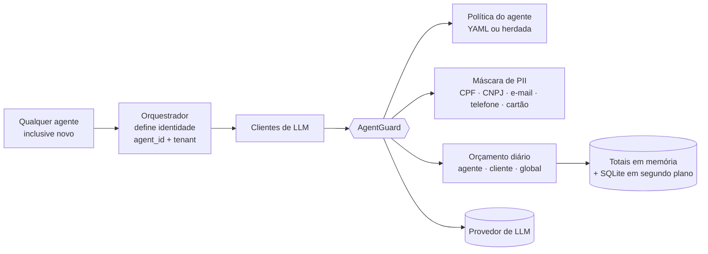

# Agent Guard: segurança como parte da arquitetura

**Problema.** Segurança escrita como módulos soltos não protege quem não os chama. Em uma plataforma em que agentes novos entram o tempo todo, a proteção precisa ser da arquitetura, e não de cada agente.

**Solução.** Um ponto único de proteção na camada de LLM. Toda chamada feita pelos clientes de LLM da plataforma (DeepSeek, OpenRouter, Claude, Gemini) passa por ele, e a identidade do agente viaja por `contextvars`, então nenhum agente precisa conter código de segurança.



## O que ele faz

| Controle | Comportamento |
|---|---|
| **Máscara de PII** | CPF e CNPJ **com validação dos dígitos verificadores**, e-mail, telefone (DDD válido, ignora intervalos de anos) e cartão (Luhn). CPF e cartão sem formatação só são mascarados com contexto ("cpf", "cartão") |
| **Orçamento diário** | Limites por agente, por cliente e globais, com gasto estimado por modelo. Leitura em memória; gravação em segundo plano, sem bloquear o event loop |
| **Política por agente** | Lê as políticas declarativas existentes; agentes sem política **herdam um padrão seguro** |
| **Agente novo** | Ao ser carregado dinamicamente, é registrado e já nasce protegido |
| **Injeção de prompt** | Sinalizada e contada, sem bloqueio (para evitar falso positivo) |
| **Observabilidade** | Endpoint administrativo com modo, contadores e maiores gastos do dia |

## Rollout seguro

- **Modo sombra por padrão:** observa e conta o que mascararia ou bloquearia, sem alterar uma única chamada. Só depois de revisar os números se liga o modo de aplicação.
- **Falha aberta em todo o caminho:** erro na construção do guard, na leitura de política, no registro de agente ou na gravação de gastos é registrado e a chamada segue. Só o estouro de orçamento, em modo de aplicação, interrompe.
- **Sem surpresa de queda:** chamadas sem identidade de agente ou de cliente só contam no limite global, nunca em um balde compartilhado.
- **Exceções explícitas:** agentes que precisam do dado pessoal original entram em uma lista de exceção.
- **Chave de liga/desliga:** `AGENT_GUARD_MODE = off | shadow | enforce`.

## Demonstração

Saída real do script de demonstração (roda offline, com um cliente de LLM simulado):

```text
1. SHADOW (padrão): observa, nunca altera
   prompt enviado ao modelo : Colaborador CPF 529.982.247-25, email ana@acme.com
   teria mascarado          : 2 itens

2. ENFORCE: a mesma chamada, o dado pessoal não sai da plataforma
   prompt enviado ao modelo : Colaborador CPF [CPF], email [EMAIL]

3. Um agente NOVO é conectado (sem escrever código de segurança para ele)
   política herdada         : group=inherited pii_mode=mask source=inherited
   prompt enviado ao modelo : Cliente CNPJ [CNPJ] pediu reembolso

4. Kill-switch de orçamento
   bloqueado                : daily agent budget exceeded
```

## Como foi validado

- **40 testes** próprios: máscara, políticas, modos, orçamento, falha aberta, propagação de contexto, clientes síncronos e assíncronos, persistência e ausência de I/O de banco no caminho quente.
- A suíte completa do repositório rodou na branch e na `main`: **nenhuma falha nova**.
- **Revisão independente** do diff, que aprovou o modo sombra e apontou riscos antes do modo de aplicação. Todos os pontos altos e médios foram corrigidos, cada um com teste: construção do guard sem falha aberta, I/O de disco bloqueando o event loop, balde de orçamento compartilhado, falsos positivos de telefone, CPF e cartão, regex de e-mail com custo quadrático e conteúdo não textual.
- Dois defeitos reais foram achados pelos próprios testes e corrigidos (janela de dígitos desalinhada na detecção de cartão; entrada "inválida" que era um CPF válido).

## Limites conhecidos (plano de trabalho)

- **Dois pontos chamam o SDK do provedor direto** (o gerador de conteúdo de SEO e um módulo de engenharia) e ainda não passam pelo guard.
- **Existe um segundo orquestrador** e alguns laços em segundo plano que rodam fora do `execute_task`; as chamadas deles caem no balde "sem identidade" até receberem contexto.
- **Orçamento por instância:** em disco efêmero ou com várias instâncias, os totais não são compartilhados. Em produção, apontar `AGENT_GUARD_DB` para disco persistente ou migrar o livro-razão para o banco.
- O modo de aplicação só deve ser ligado depois de uma semana de dados em modo sombra.

## Como isso se conecta ao trabalho

Segurança, qualidade e governança em soluções de IA, acompanhamento de custo e de métricas, e testes e otimização do comportamento dos agentes: este módulo é um exemplo de cada um, em código, com testes, revisão e plano de rollout.

## Status

Implementado e testado em branch do repositório privado (`feat/central-agent-guard`), com revisão aplicada. A ativação em produção será em modo sombra, depois do merge.

Código (recorte do repositório privado): [../examples/agent_guard/](../examples/agent_guard/)
