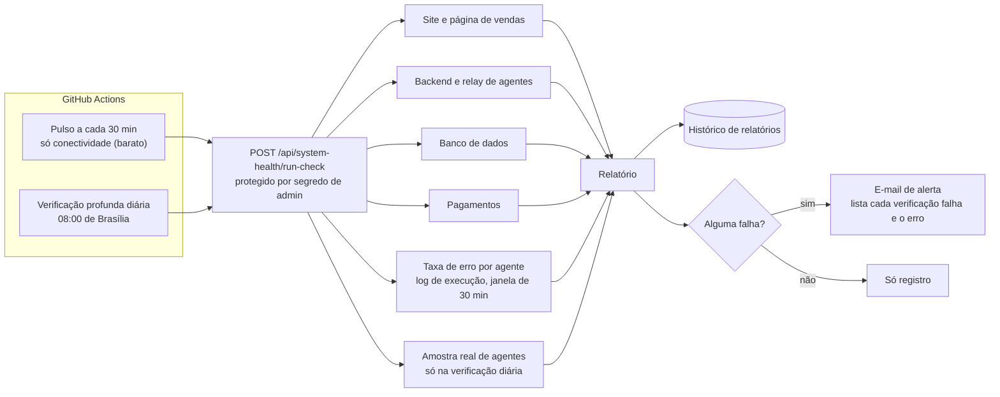

# Saúde dos agentes e reporte de erros

Uma plataforma de agentes falha de formas silenciosas: o site cai, um provedor muda, um agente começa a errar metade das chamadas e ninguém percebe. Esta página descreve como a AION detecta isso e como reporta.

## Visão geral

## Duas cadências, com motivo

| Verificação | Quando | O que faz | Por que assim |
|---|---|---|---|
| **Pulso** | A cada 30 minutos | Conectividade: site, backend, banco, pagamentos, relay de agentes, picos de erro | Barato. Existe porque uma queda de domínio ficou horas sem ser notada; agora é detectada em minutos |
| **Profunda** | Uma vez por dia, 08:00 (Brasília) | Tudo do pulso e uma chamada real a agentes do orquestrador | Gasta tokens de LLM, então roda uma vez por dia, e não a cada 30 minutos |

Os dois são disparados pelo GitHub Actions. O job falha se o endpoint responde com erro, e os dois também podem ser acionados manualmente.

## O que é verificado

- **Superfícies públicas:** site, página de vendas, backend e relay de agentes (resposta abaixo de 400).
- **Dados e cobrança:** leitura no banco e consulta à API de pagamentos.
- **Saúde por agente, pelo comportamento:** para cada agente, se houve pelo menos 3 chamadas na última meia hora e metade ou mais falhou, ele entra no relatório como pico de erro.
- **Amostra viva (só na diária):** o orquestrador é iniciado e agentes reais recebem uma tarefa trivial; resposta com erro conta como falha.

## Sinal por agente: dois registros com papéis diferentes

| Registro | Responde | Conteúdo |
|---|---|---|
| **Log de execução** (operacional) | *Como o agente se saiu?* | Agente, duração, sucesso ou falha, mensagem de erro truncada e o **commit implantado** naquele momento |
| **Recibos de conformidade** (auditoria) | *O que o agente fez?* | Trilha encadeada de ações, com ferramenta, argumentos, resultado e risco |

O commit gravado em cada linha dá rastreabilidade mínima de versão: dá para saber qual código estava no ar quando um agente falhou. O registro é *fire-and-forget*: uma falha ao gravar o log nunca quebra a chamada do agente.

## Reporte de erros

1. **Persistência:** cada execução, com sucesso ou falha, grava um relatório (momento, tipo, total de verificações, falhas e detalhe de cada uma).
2. **Alerta:** havendo falha, sai um e-mail com a contagem e a lista de verificações que falharam, cada uma com o erro ou o código de status. O destinatário é configurável por variável de ambiente.
3. **Falha visível no agendador:** o job do Actions termina com erro quando o endpoint falha.

## Decisões de design

- **Detectar e reportar, sem autocorreção.** O agente de saúde não faz rollback, não troca de modelo e não altera nem implanta código sozinho. Em um sistema que cobra clientes, um agente corrigindo e publicando código sem revisão é um risco maior do que a falha que ele tentaria resolver. O objetivo é um relatório rápido e claro para uma pessoa agir.
- **Custo proporcional à cadência.** Checagens baratas rodam a cada 30 minutos; as que chamam LLM, uma vez por dia.
- **O monitor não pode derrubar o monitorado.** Falhas na gravação de relatório ou do alerta são registradas e ignoradas.

## Limites conhecidos

- A verificação profunda exercita uma **amostra pequena** de agentes (hoje o arquiteto e o Quality Critic), não todos.
- O sinal de erro por agente cobre os agentes que passam pelo orquestrador. Os produtos que rodam em routers próprios dependem do pulso de conectividade e dos logs do serviço.
- O log de execução não guarda custo por chamada; esse dado passa a existir com o [Agent Guard](AGENT_GUARD.md), que tem um livro-razão de gasto e um endpoint de status.
- O alerta é só por e-mail. Um canal de plantão (mensagem instantânea ou pager) é o próximo passo natural.
- O endpoint que lista os agentes mostra o estado de inicialização, não o resultado de execuções. O sinal real de saúde vem do log de execução.

## Código

[../examples/health_check/system_health_agent.py](../examples/health_check/system_health_agent.py) e os dois fluxos do agendador em [../examples/health_check/](../examples/health_check/).
