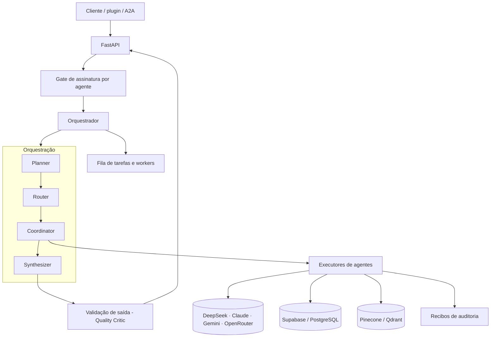

# Arquitetura multiagente

## Visão geral

## Camadas

**1. Entrada.** Três portas para o mesmo conjunto de agentes: endpoints REST por produto (compliance, engenharia, voz), um executor genérico por `agent_id` (`POST /api/agents/execute`) e o protocolo **A2A** (`/a2a/jsonrpc`, `message:send`, `message:stream`, tarefas e cartão do agente estendido).

**2. Gate de acesso.** Antes de executar, o backend confere se o plano da assinatura do cliente inclui o agente pedido. Sem isso, a chamada é recusada.

**3. Orquestração.** Planner, router, coordinator e synthesizer. A execução é registrada em banco (`agent_executions`) e enfileirada para workers; se o banco estiver indisponível, o orquestrador cai para execução síncrona em vez de falhar.

**4. Executores.** O núcleo de engenharia (arquiteto, estrutural, MEP, BIM, custos, cronograma, qualidade, segurança do trabalho) e os agentes de inteligência (client intelligence, quality critic, regulatory watch, council) têm executores reais ligados ao orquestrador. Os produtos de compliance e engenharia vendidos hoje rodam em módulos e routers próprios, fora desse mapa.

**5. Validação de saída.** O Quality Critic revisa as saídas de texto livre (risco de alucinação e de mascaramento). Saídas estruturadas e determinísticas são isentas por desenho.

**6. Workers.** Workers por domínio (engenharia, venda cruzada, Microsoft, regulatório) e um worker de LinkedIn com pipeline de vendas.

## Padrões de design

- **LLM só onde o julgamento é necessário.** Catálogos regulatórios fixos conduzem a avaliação; o modelo responde perguntas estreitas por item; uma função determinística decide pontuação e limiares → [../examples/csrd_deterministic_agent.py](../examples/csrd_deterministic_agent.py).
- **Grafos para fluxos concorrentes.** O pipeline de voz usa LangGraph com nós paralelos e um nó de compliance → [../examples/voice_call_langgraph_excerpt.py](../examples/voice_call_langgraph_excerpt.py).
- **Camada multi-LLM com fallback.** DeepSeek como padrão, Claude e Gemini por clientes diretos, e OpenRouter como gateway de provedores. O gerador de conteúdo degrada para outro provedor se o primeiro falha ou fica sem crédito.
- **RAG como memória semântica.** Índice vetorial no Pinecone com embeddings da OpenAI (fallback via OpenRouter), usado para detectar conteúdo duplicado por similaridade e para isolar o histórico de cada site → [../examples/seo_semantic_memory_excerpt.py](../examples/seo_semantic_memory_excerpt.py).
- **Degradação segura.** Módulos opcionais viram no-op quando não configurados, para o pipeline de produção nunca quebrar por falta de uma chave.

## Honestidade técnica

O orquestrador genérico tem um grafo LangGraph esqueleto (plano fixo) que não é o caminho de execução dos produtos; o valor real está nos executores, nos routers de produto e no fluxo de voz. Agentes que só existem no registro estão marcados como *Catalogado* no [portfólio](AGENT_PORTFOLIO.md).
